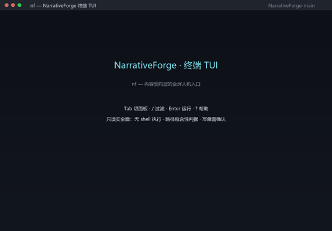

# NinFenz · Documentation Workshop (spec-driven)<sub>文档生成工坊（规范驱动）</sub>

<!-- nf:locales -->
<p align="center">
  <a href="README.md">简体中文</a> · <strong><a href="README.en.md">English</a></strong> · <a href="README.ja.md">日本语</a>
</p>

<p align="left">
  <a href="https://github.com/Monyeah777/NinFenz/actions/workflows/ci-verify.yml"></a>
  <a href="https://glama.ai/mcp/servers/Monyeah777/NinFenz/score"></a>
</p>

> **Canonical repository**: https://github.com/Monyeah777/NinFenz | npm `ninfenz` | GitHub Packages `@monyeah777/ninfenz`
> Same-named repositories under other accounts are **unauthorised mirror snapshots**; they do not represent this project and accept no issues or PRs.

**Live site**: https://ninfenz.dev · machine entry [llms.txt](https://raw.githubusercontent.com/Monyeah777/NinFenz/main/llms.txt)

**NF terminal (TUI) demo** — a full-screen human entry built on the standard library only; its menu and actions are controlled callers of the real `nf` CLI.
Keybindings follow the mainstream terminal conventions: `Tab` switches panes, `↑↓` moves inside the focused pane, `/` filters, `?` opens the keymap.



<details>
<summary>Demo frame text - byte-for-byte the `--demo` renderer output, kept for search/copy</summary>

```
┌ NF TUI v1.0.0 · NinFenz 内容契约层 ──────────────────────────────────────────────────────────┐
│仓库 NinFenz · 能力区 9                                           焦点 动作 · 就绪（0 项待办）│
├────────────────────────┬─────────────────────────────────────────────────────────────────────┤
│  能力区 1/9            │▍ 动作 · 环境自检（2）                                               │
│▸ 0 环境自检（2）       │❯ 只读体检   nf doctor                                               │
│  1 一键演示世界（1）   │  体检（机器面）                                                     │
│  2 需求 → 装配计划（2）│                                                                     │
│  3 全链生产（2）       ├─────────────────────────────────────────────────────────────────────┤
│  4 校验与体检（4）     │  输出 · 1-3/3 · 已跟随                                              │
│  5 货架与资产（4）     │❯ nf doctor   （退出码 0 · 0.42s）                                   │
│  6 管线与模块（4）     │环境自检：Python 3.11 · 仓库在场 · 模块 13 · 管线 3                  │
│  7 帮助与命令面（2）   │✔ 只读体检通过：无缺件 / 无越界 / 无非确定性输出                     │
│  8 写盘表单（13）      │                                                                     │
│                        │                                                                     │
│                        │                                                                     │
│                        │                                                                     │
│                        │                                                                     │
│                        │                                                                     │
│                        │                                                                     │
│                        │                                                                     │
│                        │                                                                     │
│                        │                                                                     │
│                        │                                                                     │
├────────────────────────┴─────────────────────────────────────────────────────────────────────┤
│ Tab 切面板 · ↑↓ 移动 · / 过滤 · Enter 运行 · ? 帮助 · q 退出                                 │
└──────────────────────────────────────────────────────────────────────────────────────────────┘
```

</details>

`python tui/nf.py` opens the full-screen UI; `--selftest` runs the security self-check, `--demo` prints exactly the frame above, and `--exec "nf doctor"` is the scriptable surface
(no TTY needed either: `--list-actions --json` gives agents the actions and exit codes). Commands run on a worker thread, so `Ctrl-C` while running cancels just that command;
path arguments pass repository-containment checks, writes require typing `yes`, and API keys are read from the environment and masked. A single-file executable is shipped alongside.
Details: `tui/README.md`.

> MIT License · original open source · please cite the source when deriving/referencing

**In one sentence**: NF is a **content contract layer** — it defines the protocols, quality gates and asset standards for "AI reliably produces long-form content"; narrative is only the first official domain package, while the protocol itself is domain-neutral and model-agnostic.

**Aliases & keywords**: NF · NinFenz · 宁封子 · content contract layer · spec-driven content factory · long-form content generation · assembly-based content production · module/pipeline/asset · quality gate · domain pack · MCP.

**What it is not**: not a model, not a prompt-template collection, not a vendor SDK — the protocol itself is domain-neutral and model-agnostic, and MCP is just one supported connection protocol.

`bash verify.sh`（check 数与脚本版本以生成的统计区为准；本文档不钉运行时计数） · `python scripts/nf.py stats --check`

> **Bilingual rule**: this file mirrors `README.md` section by section; the Chinese `README.md` is authoritative. The machine-checkable facts (version, check count, PASS baseline, protocol files, machine entries) are asserted identical by `verify.sh` check34 — a drift fails the gate.
> 最后更新：2026-09-20

## ⚡ If you are an AI / Agent

- What this is: a spec-driven document factory — load modules/pipelines/assets → validate → emit.
- Entry chain: `docs/agent/AGENT_START.md` (start) → `docs/agent/AI_ROUTING.md` (pick a route) → `docs/meta/DEEP_DIVE.md` (go deep).
- Machine credential: `bash verify.sh` (run it locally — the static check count and script version live in the generated stats block below; runtime counters are deliberately not pinned in prose); the machine entry list is `llms.txt`; locales are `README.en.md` · `README.ja.md` (all three entries' machine facts and language switcher lines are asserted consistent by check34's locale scan; registry = `protocol/locales.json`).
- To understand why NF is designed this way: read [docs/meta/DEEP_DIVE.md](docs/meta/DEEP_DIVE.md).

## Quick start

First hop: follow the 6 copy-paste steps in [`docs/quickstart.md`](docs/quickstart.md); one-command self-check: `bash scripts/quickstart_check.sh` (exit 0 · wall clock ≤ 300 s · doc steps == script steps, enforced by check39).

Human (author/developer, 5 minutes):

1. `bash verify.sh`
2. `python scripts/nf.py shell` (interactive terminal — the human entry after the shell line retired; see `docs/terminal.md`)
3. `python scripts/nf.py demo`
4. `python scripts/nf.py --help`
5. `python scripts/nf.py doctor`
6. `python scripts/nf.py completion bash`

> **Security boundary (`nf verify` executes the target repository's own gate scripts)**: the engine
> runs the embedded Python from the target repo's `verify.sh` **in-process** (CWE-94). It therefore
> only trusts repositories whose `origin` owner is allowlisted (default: `Monyeah777`); on foreign or
> untrusted repositories it **refuses by default** (exit 2 + remediation guidance) — pass
> `nf verify --trust-repo` explicitly to override (at your own risk), and extend the allowlist with
> `NF_TRUST_OWNERS` for forks/mirrors. For read-only checks use `bash verify.sh`. See
> [SECURITY.md](SECURITY.md).

AI assembly:

1. Read `docs/agent/AGENT_START.md`
2. Read `docs/agent/agent_组装指令包_v0.2.md`
3. Take `01_核心协议.md` / `02_联动注册表.md` / `06_Agent执行协议.md` / `07_官方核心出厂与社区预设导航.md` and community packages as needed
4. Assemble a self-contained full version and pass the `##7` self-check
5. `nf assemble "<requirement>" --build --dest <dir>` (assembly command: emits an "full version" single file directly)
6. `nf assemble "<requirement>" --check <out.md>`

### FAQ

- **What is NF?** A content contract layer: protocols + quality gates + asset standards that make "AI reliably produces long-form content" loadable, checkable and reproducible.
- **Is NF an MCP server?** Not necessarily — protocols and assets are plain text, so a clone or a raw link is enough; `nf serve` adds an MCP surface.
- **Which models are supported?** Model-agnostic: any text-capable AI can assemble and load the protocols; nothing is bound to a vendor or a connection protocol.
- **Does it need network access?** No. The repository is markdown source; `bash verify.sh` is local-only and runs offline.
- **How is output judged?** Only by the internal chain: the verify gate (statically checkable) + the five-axis depth review + real drills. External praise is not used as quality evidence.
- **How do I cite it?** MIT license; please credit the source — machine-readable metadata lives in `CITATION.cff` at the repository root.
- **Export & compliance?** Cryptography uses only the standard library plus external `ssh-keygen` (no home-grown algorithms); the export-control reading is in `docs/EXPORT.md`.

## Capabilities and assets

<!-- nf:stats:begin -->
**Official core**: 13 modules · 3 pipelines (P00 / P01 / P90) · protocol files 01-07
**Community scale**: 111 registered packs · 363 asset files · 101 concept graphs · 100 domain packs / 1200 subdivisions · standards catalog 370 (reachable 332 / unreachable 38 · 194 bodies · 206 dependency edges) · standard bindings 1200
**Quality evidence**: verify v2.30 · check1-42 · PASS=76 (`bash verify.sh`; expectations from `quality_baseline.EXPECTED_*`) · library 3 items

> Generated by `python scripts/nf.py stats --write`. Do not edit by hand; sources in `protocol/repo_stats.json`.
<!-- nf:stats:end -->

## Protocol chain and documentation map

| Layer | Entry |
|---|---|
| Direction | `STRATEGY.md` |
| Protocol | `01_核心协议.md` · `02_联动注册表.md` · `06_Agent执行协议.md` · `07_官方核心出厂与社区预设导航.md` · `protocol/WORLD_MODEL.md` |
| Library | `03_管线库/` · `04_模块库/` · `05_资产库/` |
| Community | `community/README.md` · `community/模板制作指令包.md` |
| AI | `docs/agent/AGENT_START.md` · `docs/agent/AI_ROUTING.md` · `docs/meta/DEEP_DIVE.md` |
| Tooling | `docs/mcp.md` · `docs/terminal.md` · `docs/layers.md` · `docs/release.md` · `scripts/nf.py` · `tui/nf.py` · `verify.sh` |
| Integrations | `integrations/README.md` (MCP / LSP / CLI / TUI / library / Skill / npm / Rust / .NET / A2A) |
| Collection | `library/INDEX.md` · `docs/agent/ROUTES.md` |

## Versions

Install **`ninfenz` 1.0.5** today — published to both npm and GitHub Packages:

```bash
npm i -g ninfenz@latest   # install or upgrade
nf --version             # show current version
nf stats                 # show gate and repo status
```

Three independent version lines ship from the same repository:

| Line | Current | What it governs |
|---|---|---|
| **Content & protocol** | **v0.93** | Templates, domain packs, specs — *what* can be generated |
| **Command-line tool** | **1.0.5** | the `nf` command / npm package / MCP server — *how* you use it |
| **Quality gate** | see `nf stats` | self-check status — *whether* something broke |

Last three content releases, described by **what they add**:

| Version | Date | What this release adds |
|---|---|---|
| v0.93 | 2026-10-05 | knowledge-layer retrieval, terminal surface, digital-asset contracts (reusable across projects) |
| v0.92 | 2026-09-10 | world-state model: deterministic abstract state + slots (same input, same output) |
| v0.82 | 2026-09-09 | 45-point quality depth plus foundation layer A |

Release rules (since 2026-10-20): the content line uses `v0.xx` — small updates fold into the current release, a modest breakthrough adds **0.01**, an innovation adds **0.1**; the CLI line
is versioned independently as `1.0.x`; every release updates `CHANGELOG.md`, and tags are placed
on the commit that **carries the feature**.

